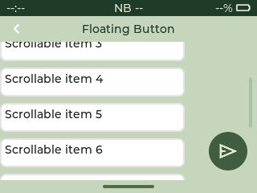

# LVGL 显示与输入适配

锁定 LVGL 9.5.0，独立任务拥有全部 LVGL 调用。启动同步等待最多8秒。
ST7789T3 驱动位于 `drivers/st7789`，40MHz SPI2、RGB565、逻辑320×240横屏。
`bepio_ui_display.c` 使用两个16行绘制缓冲与一个面板传输缓冲，每个10KB，总共30KB内部DMA内存。
这些缓冲独立于64KB LVGL内存池，不依赖PSRAM。
绘制下一个块时，前一个块由DMA发送；复用面板缓冲前通过LVGL flush-wait回调等待完成。
ISR释放完成信号量，并在唤醒高优先级任务时显式请求调度；所有LVGL调用均在GUI任务中执行。
ESP-IDF 5.5.3 的 SPI post 回调未使用 LCD 回调返回的唤醒标志，因此不能仅返回bool等待上层调度。
旋转与RGB565字节序打包合为一次处理，触摸坐标映射保持 `x=319-raw_y,y=raw_x`。
200ms超时或提交错误会停止GUI任务并保留DMA缓冲至复位，不让晚到的DMA读到释放/覆盖的内存。
先完成首页传输并点亮GPIO8背光，再尝试FT6336 I2C1，失败仍保留首页。

触摸由独立任务每10ms读取I²C并发布固定大小快照；LVGL输入回调仅读取快照，不执行I²C事务。
快照用短临界区保护，超过100ms未更新则报告松手；读取错误停用采样直至复位。
LVGL输入定时器设10ms、显示刷新定时器设20ms（目标50Hz），GUI循环最多休眠10ms。
这些周期通过运行时API覆盖默认33ms，实际频率仍受FreeRTOS tick、绘制和带宽限制。
整屏RGB565在40MHz下仅像素传输仍约30.7ms，设置20ms不代表能达到整屏50FPS。
默认串口REPL关闭；应用视图仍不支持任意线程调用。

## 公共页面与系统导航

`widgets/lv_page.*` 按 DeepStoa 的 `lv_page` 骨架移植，接口以 `bepio_` 为前缀：
顶层常驻状态栏 24px、页面 header 44px、左上返回触摸区域 40×40、内容区 240×232、底部手势条 20px。
页面返回按钮调用 app-manager 的 back 分发，应用可消费返回事件以关闭键盘、返回上级或处理未保存内容。
应用只清理/渲染 `page.container`，不清理公共 header 和状态栏。

`widgets/lv_status_bar.*` 沿用 DeepStoa 的 `lv_layer_top()` 常驻方案，仅在文本变化时刷新 label。
默认时间 `--:--`、蜂窝状态 `NB --`、电量 `--%`。Bepio 尚无已接入的时钟同步、电量采集与蜂窝注册状态源；
这些字段不伪造数值。后续由 GUI 任务调用 `bepio_status_bar_update()` 填入已验证数据。

`widgets/bepio_navigation.*` 按 DeepStoa 的全局 indev 监控方式识别上划：从屏幕底部 24px 内起划，
上移至少 40px，横向偏移不超过 40px。只在 app 打开时显示退出确认；Cancel 保持当前界面，
Exit 异步停止当前 app 并回到 Launcher，不逐层执行返回。未保存编辑的保留行为由应用 stop/start 策略决定，
Messages 会保留内存中的编辑状态；Contacts 的未保存编辑会被清除，已保存联系人仍保留到重启。
退出弹窗明确提示可能丢失未保存编辑。
键盘与应用内容位于手势区上方。触摸输入在初始化后仅安装一次导航监听。

移植来源：`D:/Codes/DeepStoa/system/uilv/widgets/lv_page.*`、`lv_status_bar.*` 与
`system/launcher/launcher_gesture.c`；保留 DeepStoa/EPOS 来源与 GPL-3.0-only 声明。
未引入其电子纸、Wi-Fi、字体/图片资源或 Zephyr 运行依赖。

预览见 [navigation-preview.png](../../docs/assets/navigation-preview.png)，为实际 LVGL 主机渲染。
实板仍需检查状态栏/内容边界、四角触摸、左上返回、底部上划确认与键盘打开时的退出。

## 显示与触摸验证

实板检查 Contacts 连续滚动、颜色和撕裂、进入退出、键盘及触摸松手；检查 GUI 与触摸任务栈余量和内部 DMA 堆。
显示故障和触摸超时仍需实板验证。主机回归：`python tests/unittest/display_async/run.py`、
`python tests/unittest/orientation/run.py`；显示管线集成测试见 `tests/integration/launcher_preview/README.md`。

## 根据实板日志进一步定位

用户提供的40MHz异步管线日志中，滚动窗口的单次刷新平均66.6～73.8ms、最大约86.6ms，
LVGL消费触摸的最大间隔约100ms（切页窗口曾达140ms）；独立触摸采样仍约10ms。
每块DMA约2.2ms、旋转约0.35ms、完成回收剩余等待平均仅26～38us。
64帧窗口每帧平均约97.6KB像素，40MHz下仅像素线传输约19.5ms，不能用SPI带宽单独解释66.6ms刷新时间。
这些数据说明GUI刷新/调度路径仍有明显开销，不足以直接断言某一种圆角或字体绘制就是主因。

检查 `build/compile_commands.json` 确认此前真实LVGL核心/软件绘制只有 `-Og`，
构建过程中的 `USING O3` 文本不能作为这些文件启用O3的证据。
现默认开启 `CONFIG_BEPIO_UI_OPTIMIZE`，由根CMake在IDF组件注册后为
`lvgl__lvgl`、`uilv`、`st7789`、`esp_lcd`追加 `-O2`；最终命令中 `-O2` 位于 `-Og` 后，
其他业务/系统组件维持原编译策略。保留符号和断言；需要逐语句调试图形时可在menuconfig关闭此选项。

## Floating action button

widgets/lv_floating_button.c/.h adapts DeepStoa's fixed circular action button to the 320x240 LCD. Default diameter is 48px, bottom/right margin 12px and extended hit area 8px. The green/pale icon palette follows the launcher. IGNORE_LAYOUT and FLOATING keep the button out of flex/grid layout and stationary when its parent scrolls. This is an anchored action button; it is not draggable.

Use bepio_floating_button_create(parent, LV_SYMBOL_PLUS, callback, user_data) for a symbol, or bepio_floating_button_create_image(parent, image_descriptor, callback, user_data) for a monochrome recolored image. New APIs use the project bepio_ prefix. Callback receives LV_EVENT_CLICKED; user_data is passed unchanged. A NULL symbol defaults to +, a NULL callback is allowed, and NULL parent/image is rejected. Image data must remain alive until button deletion. Create/update/delete only on the LVGL owner thread; the parent owns the button. Standard LVGL flags/states control visibility and disabled state.

Example: bepio_floating_button_create(page.container, LV_SYMBOL_PLUS, on_add, context).

The actual LVGL floating_button_preview test verifies symbol/image constructors, bottom-right position, independence from flex layout and parent scroll, real pointer activation and extended hit area, disabled/hidden behavior, optional callback and parent cleanup. The component is available to business pages; the preview demonstrates it without adding a global overlay to all apps.

